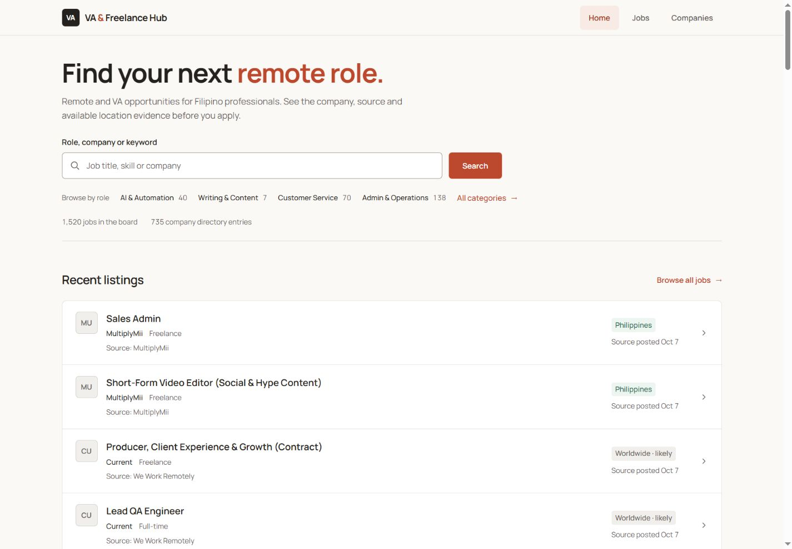

# Premium 2026 frontend acceptance

## 2026-10-07 23:30 Manila — TERMINAL / KEEP

The owner-authorized premium frontend program is complete: five of five
checkpoints (100% by frontend checkpoint count). Approved direction: Warm
Precision + Employment Intelligence, retaining cream, charcoal and deeper coral.
This percentage does not measure source autonomy or GCP migration.

## Source, release and recovery

| Receipt | Verified value |
| --- | --- |
| Independently reviewed final behavior | `98a6d1777941e7d5c27bf6d482aede6d4031655f` |
| Implementation PR | [#222 — merged](https://github.com/cyalcala/va-freelance-hub/pull/222) |
| Final pre-merge backup | `33cd404f6c1c1431f7e1d09e6641d75011d8ee94`, remotely verified |
| Required PR checks | [37641913191](https://github.com/cyalcala/va-freelance-hub/actions/runs/37641913191) at `515a68e3`; [37642948462](https://github.com/cyalcala/va-freelance-hub/actions/runs/37642948462) at `33cd404f`, both passed |
| Exact merged/runtime source | `3519878f8825ce808e6817febb5f8815ad5c467c` |
| Main validation and production release | [37643252423 — success](https://github.com/cyalcala/va-freelance-hub/actions/runs/37643252423) |
| Pages production deployment | `41bf9716-0c8f-481d-b1ff-56dd85c03832`, main/source `3519878` |
| Deployment URL | [41bf9716.remotejobs-ph.pages.dev](https://41bf9716.remotejobs-ph.pages.dev) |
| Public site | [remotejobs-ph.pages.dev](https://remotejobs-ph.pages.dev) |
| Return tag | `savepoint/pre-premium-design-2026-10-07` at `50d8daa280d74b2a34f8d9ec1ed4a8dd1a5d0c73` |
| Acceptance-document branch start | `3519878f8825ce808e6817febb5f8815ad5c467c`, `codex/premium-2026-acceptance` |

Normal GitHub merge/main writes initially returned server errors. The dated
[release checkpoint](PREMIUM_2026_RELEASE_CHECKPOINT.md) preserves those receipts.
A later normal squash merge succeeded at 15:21:33 UTC after checks passed. No
force push, reset, admin override or alternate deployment was needed. The blocker
is resolved. [Safe source return procedure](PREMIUM_2026_SAVEPOINT.md).

## Verification

Separate spec then quality reviews accepted each surface; final adversarial
review accepted the anchor, selected-navigation contrast and HTML asset-cache
fence. Main CI passed **3,018 tests / zero failures**, Python checks, typecheck,
build, four repository audits, secret scan and Worker checks. The unchanged
production workflow reported no D1 migrations to apply, verified existing
foundations/index, refreshed the serving fallback and deployed.

Exact release artifact workerd check at 15:23:10.706 UTC: eight routes 200 with
D1 absent; tracked Apply 503 / Retry-After 30 / no outbound redirect. Generation
14:36:47.152 UTC, 1,520 jobs / 735 companies. Retained
[offline receipt](evidence/premium-release-offline.json) and
[capture receipt](evidence/premium-release-capture.json). Downloaded fallback
SHA256 matches `f52afa20a6c4e58bf0422bbc0e592c49d1f881e19995b8f2ef18d1f530e04867`.
Artifact `11492129935`,
`public-availability-release-3519878f8825ce808e6817febb5f8815ad5c467c`, preserves
the actual fallback and receipts for 30 days. Git preserves source/evidence;
neither is a database restoration test.

Ordinary live requests at 15:25:11 UTC returned eleven routes and their sole
stylesheet 200. Home/board initially showed truthful stale cached state while
other data routes were fresh. The bounded follow-up at 15:30:20 UTC again returned
eleven routes/stylesheet 200, every data route fresh and no saved notice. Legal
pages have no board-state header. Both [initial](evidence/premium-live-http-metrics.json)
and [recovered](evidence/premium-live-http-recovered.json) receipts are retained.
Browser home at 1440 and 390 also showed no warning. Legitimate stale/offline
notices remain implemented.

Live native home search for MultiplyMii returned 69 results and opened detail
8992; directory native search for 20Four7VA returned one result. Detail 8992
retains its encoded original source through tracked Apply, `_blank` and
`noopener noreferrer`. Its mobile target is 44px high, clear of bottom navigation;
unknown pay/schedule remain explicit. No live Apply navigation or application
submission was performed. Desktop/mobile home and mobile detail have no overflow;
first home row starts at 548px desktop / 706.8px mobile. Recorded browser
warning/error log was empty. Local four-breakpoint and keyboard evidence remains
in the [complete review](PREMIUM_2026_REVIEW.md).

Live pages have zero hydrated islands and no external client script source.
Decoded home/board/directory HTML: 73,797 / 40,017 / 58,108 bytes; sole stylesheet
37,705 bytes, HTTP 200. These are not compressed transfer or field Core Web
Vitals. Reduced-motion rules were inspected, not OS-emulated. The once-only
detector's single-font advisory follows the explicit Manrope contract; Jev was
unavailable/advisory, not an approval.

## Boundary and continuation

No remaining premium implementation or release task. Preserve the tagged
baseline and accepted UI through ordinary reviewed releases. No auth/payments,
new dependency, source admission, ranking, eligibility, database schema, GCP
schedule or publication gate changed. The frontend HTML revision prevents old
markup from linking removed assets; privacy guards, TTLs and saved-data rules
are preserved. Original foreign `.agents/skills/` and `lucky777.md` were verified
still untracked and intact. Source/migration work retains its separate queue.

The earlier Windows smoke cleanup lock is distinct from clean Linux release
acceptance. Automatic policy blocked removing that local temporary folder, which
was retained; no production cleanup operation was attempted.
